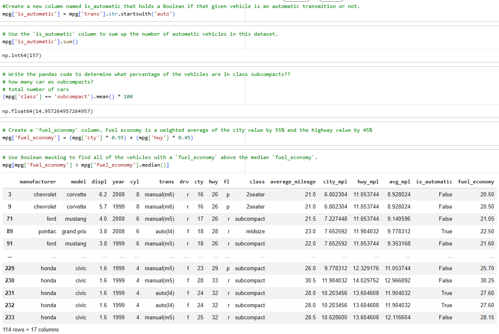
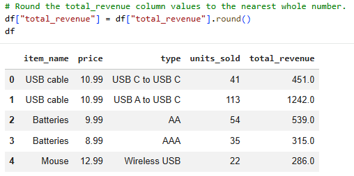

# 📊 Pandas Data Analysis & Manipulation


A hands-on collection of **Pandas-based data analysis exercises and projects** completed during the **Data Technician Skills Bootcamp**.

This repository demonstrates practical skills in:

✅ Data Cleaning  
✅ Data Manipulation  
✅ Indexing & Filtering  
✅ Exploratory Data Analysis (EDA)  
✅ Data Aggregation & Grouping  
✅ Data Visualisation with Matplotlib

---

## 📑 Table of Contents

- [📁 Repository Structure](#-repository-structure)
- [📓 Notebook Overviews](#-notebook-overviews)
- [🛠 Pandas Methods Reference](#-pandas-methods-reference)
- [🎯 Learning Outcomes](#-learning-outcomes)
- [🚀 Getting Started](#-getting-started)

---

# 📁 Repository Structure

```text
.
├── 📄 README.md
├── 📓 PandasDataFrames_01.ipynb
├── 📓 PandasDataFrames_02.ipynb
├── 📓 PandasDataFrames_03.ipynb
├── 📓 Sales_Data_Analysis.ipynb
└── 📊 datasets/
    ├── penguins.csv
    ├── student.csv
    └── sales_data.csv
```

---

# 📓 Notebook Overviews

## 1️⃣ PandasDataFrames_01.ipynb
### 📚 Introduction to Pandas & DataFrames

Learn the fundamentals of Pandas, including:

- Creating DataFrames
- Understanding Series and DataFrames
- Inspecting dataset structure
- Generating descriptive statistics
- Creating calculated columns

### Key Skills

🟢 `pd.DataFrame()`  
🟢 `.info()`  
🟢 `.shape`  
🟢 `.describe()`  
🟢 Column calculations

---

## 2️⃣ PandasDataFrames_02.ipynb
### 🔍 Indexing, Slicing & Filtering

Explore how to extract and filter data efficiently.

### Key Skills

🟢 `.loc[]` (Label-based indexing)

```python
df.loc[df['Price'] > 100, ['Product', 'Price']]
```

🟢 `.iloc[]` (Position-based indexing)

```python
df.iloc[0:5, 0:3]
```

🟢 Boolean Filtering

```python
df[(df['Price'] > 50) & (df['Stock'] < 50)]
```

🟢 Sorting Data

```python
df.sort_values(by='Price', ascending=False)
```

---

## 3️⃣ PandasDataFrames_03.ipynb
### 🧹 Data Cleaning & Missing Values

Learn how to identify, handle, and clean incomplete datasets.

### Key Skills

🟢 Detecting Missing Values

```python
df.isna().sum()
```

🟢 Filling Missing Values

```python
df['Price'].fillna(df['Price'].mean())
```

🟢 Replacing Categories

```python
df['Category'].fillna('Unknown')
```

🟢 Removing Missing Records

```python
df.dropna(subset=['Product_ID'])
```

---

## 4️⃣ Sales_Data_Analysis.ipynb
### 📈 Data Aggregation & Insights

Perform real-world sales analysis using grouping and aggregation techniques.

### Key Skills

#### Grouping Data

```python
df.groupby('Category')['Total_Value'].sum()
```

#### Multiple Aggregations

```python
df.groupby('Region').agg({
    'Price': 'mean',
    'Stock': 'sum'
})
```

#### Visualisation

```python
category_sales.plot(
    kind='bar',
    x='Category',
    y='Total_Value',
    color='skyblue'
)
```

📊 Generate meaningful charts and business insights directly from Pandas DataFrames.

---

# 🛠 Pandas Methods Reference

| Method | Purpose |
|----------|----------|
| `pd.read_csv()` | Load CSV data |
| `.head()` | Preview records |
| `.info()` | Inspect structure |
| `.describe()` | Summary statistics |
| `.loc[]` | Label-based selection |
| `.iloc[]` | Position-based selection |
| `.isna()` | Detect missing values |
| `.fillna()` | Replace missing values |
| `.dropna()` | Remove missing records |
| `.groupby()` | Aggregate data |
| `.sort_values()` | Sort datasets |

---

# 🎯 Learning Outcomes

Through this project, I developed practical experience in:

✅ Loading and exploring structured datasets

✅ Cleaning and preparing real-world data

✅ Handling missing values effectively

✅ Applying filtering and indexing techniques

✅ Performing grouped analysis and aggregations

✅ Generating insights from business datasets

✅ Creating visualisations using Matplotlib

✅ Using Pandas for end-to-end data analysis workflows

---

# 🚀 Getting Started

## Option 1: Google Colab

1. Open any notebook (`.ipynb`)
2. Click **Open in Colab**
3. Run cells directly in your browser

---

## Option 2: Local Environment

Clone the repository:

```bash
git clone https://github.com/your-username/python-pandas-exercises.git
```

Navigate into the project folder:

```bash
cd python-pandas-exercises
```

Launch Jupyter Notebook:

```bash
jupyter notebook
```

---

## 📸 Code Examples & Output Screenshots

### 🚗 Pandas Analysis: Vehicle Dataset Manipulation & Boolean Masking

* **Task Description:** Performing complex data manipulations on the automotive `mpg` dataset—including creating calculated Boolean columns, computing percentages, calculating weighted averages for fuel economy, and applying Boolean masking to filter vehicles above the median threshold.

* **Code Execution & Output:**
  
  

* **Technical Explanation:**
  * **String & Boolean Operations:** Uses `.str.startswith()` to flag automatic transmissions and `.sum()` to aggregate total counts.
  * **Calculated Columns & Averages:** Computes weighted averages combining city and highway metrics (`0.55` and `0.45` weights respectively) to generate the `fuel_economy` column.
  * **Boolean Masking:** Filters the entire DataFrame dynamically using statistical median values (`.median()`) to isolate high-efficiency vehicles.


### 📊 Pandas Exercise: Sales Data Manipulation & Revenue Calculation

* **Task Description:** Creating a DataFrame from a dictionary of items, cleaning and converting data types (`price`), adding new sales columns, calculating total revenue, rounding values, and exporting datasets to CSV and Excel formats.

* **Code Execution & Output:**
  
  

* **Technical Explanation:**
  * **Data Structuring:** Initializes a Pandas DataFrame from raw dictionary structures and renames columns for standardisation.
  * **Data Cleaning & Type Conversion:** Uses `.str.replace()` and `.astype(float)` to clean currency strings and convert them into numerical formats.
  * **Feature Engineering:** Multiplies price by units sold to create a new `total_revenue` column, applies `.round()` for formatting, and exports the processed data using `.to_csv()` and `.to_excel()`.

---

## 🧰 Technologies Used

- 🐍 Python
- 🐼 Pandas
- 📓 Jupyter Notebook
- 📊 Matplotlib
- 🔢 NumPy

---

## 👨‍💻 Author

Created as part of the **Data Technician Skills Bootcamp** to demonstrate practical data analysis and manipulation skills using Python and Pandas.

⭐ If you found this repository useful, consider
